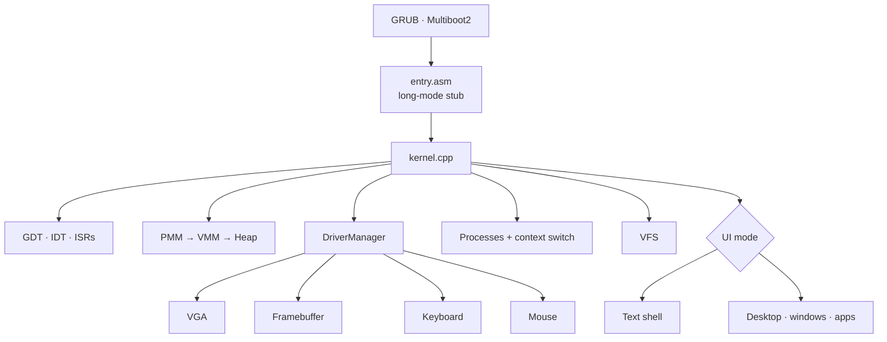

<div align="center">

# 🖥️ MertOS

**A 64-bit hobby operating system written from scratch in C++17 and NASM**


[Features](#-features) · [Architecture](#-architecture) · [Build & run](#-build--run) · [Türkçe](#-türkçe)

</div>

---

MertOS boots through GRUB into a long-mode x86_64 kernel. From there it brings up memory
management, interrupts, drivers, a process model and a small virtual file system, then starts
either a text shell or a **windowed desktop** with its own apps. Every subsystem is written
by hand, with no libc or STL, and it is designed to show core OS concepts in clean,
object-oriented C++.

## ✨ Features

| Area | What's inside |
|---|---|
| **Boot** | Multiboot2 header, GRUB `grub-mkrescue` ISO, 64-bit entry stub in NASM |
| **CPU** | Custom GDT and IDT, ISR stubs, exception and IRQ handling, PIT timer ticks |
| **Memory** | Bitmap **physical memory manager**, page-table **virtual memory manager**, kernel **heap** allocator |
| **Processes** | Process control blocks and assembly **context switching** |
| **IPC** | Type-safe `MessageQueue<T, N>` template |
| **Drivers** | VGA text mode, linear **framebuffer**, PS/2 **keyboard** and **mouse**, all behind a polymorphic `Driver` base class |
| **File system** | In-memory **VFS** with files and directories |
| **Shell** | `help`, `echo`, `mem`, `ps`, `ver`, `color`, `alias`, `hexdump`, `panic`, `reboot`, `halt` … |
| **Desktop** | Splash screen, window manager, event loop, **terminal**, **file manager**, **settings** and **Mert Studio Code** apps |

## 🧩 Architecture



The kernel leans on OOP on purpose. Drivers inherit from `Driver` and are initialised
polymorphically, and the PMM, VMM, heap and process state are encapsulated behind small interfaces.

## 🚀 Build & run

MertOS is built on Linux or **WSL2** with an `x86_64-elf` cross-compiler
(the Makefile falls back to `x86_64-linux-gnu-*`).

```bash
bash setup_wsl.sh     # installs nasm, qemu, grub, xorriso and the cross toolchain
make                  # → kernel.elf + MertOS.iso
make run              # boots the ISO in QEMU
make debug            # QEMU + GDB server on :1234
make clean
```

## 📁 Project structure

```
kernel/
├── arch/x86_64/   entry.asm, GDT, IDT, ISR stubs
├── memory/        multiboot2 parsing, PMM, VMM, heap
├── process/       processes and context_switch.asm
├── drivers/       driver base, VGA, framebuffer, keyboard, mouse
├── ipc/           MessageQueue<T, N>
├── fs/            virtual file system
├── shell/         text-mode shell
├── desktop/       window manager, widgets, theme, apps
└── kernel.cpp     boot sequence
libc/include/      freestanding string helpers
iso/boot/grub/     grub.cfg
kernel.ld          linker script
```

## 🇹🇷 Türkçe

**MertOS**, C++17 ve NASM ile sıfırdan yazılmış 64 bit bir hobi işletim sistemidir. GRUB/Multiboot2
ile açılır. GDT/IDT ve kesme yönetimi, fiziksel ve sanal bellek yönetimi, heap, süreçler ve bağlam
değiştirme, mesaj kuyruğu (IPC), sanal dosya sistemi, klavye/fare/framebuffer sürücüleri içerir.
Metin kabuğunun yanında pencereli bir masaüstü (terminal, dosya yöneticisi, ayarlar ve
Mert Studio Code uygulamaları) sunar. WSL2 üzerinde `bash setup_wsl.sh && make run` ile QEMU'da çalıştırılabilir.

---

<div align="center"><sub>Built by <a href="https://github.com/Soap2647">Mert Yasin Yılmaz</a></sub></div>
